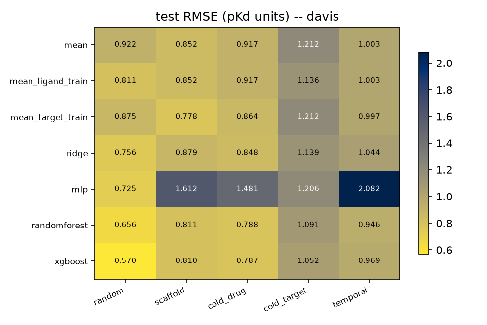
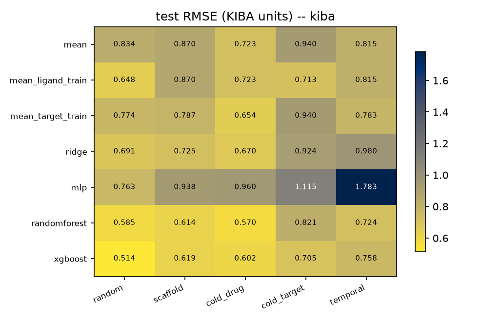
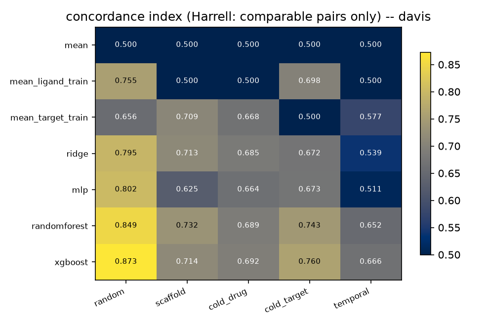
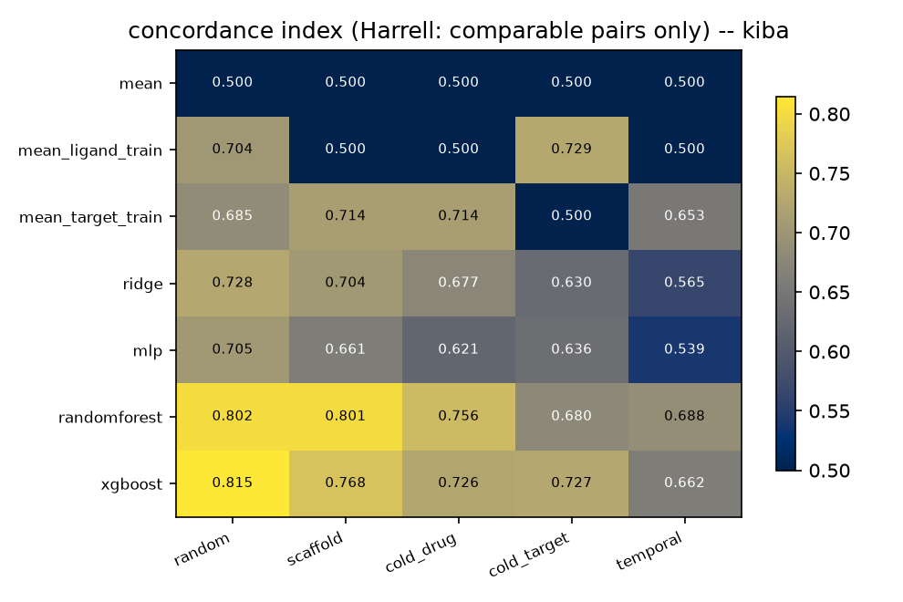

# DTI affinity benchmark -- results report

Generated by `scripts/07_report.py`. Every number below is read from a file written by the numbered scripts; nothing here is re-fitted.

## 1. Data

| dataset | rows | ligands | targets_by_sequence | targets_by_name | label | on_censor_ceiling |
|---|---|---|---|---|---|---|
| DAVIS | 30056 | 68 | 379 | 442 | pKd (Kd nM, clipped 0.016-10000) | 0.6964 |
| KIBA | 118254 | 2068 | 229 | 229 | KIBA score (0-17.2) | 0.0000 |

## 2. Split protocols and leakage

| dataset | protocol | n_train | n_valid | n_test | test_ligands | test_ligands_absent_from_train | test_targets_absent_from_train | test_scaffold_present_in_train | test_pairs_with_near_duplicate_ligand_ge0.7 | target_max_dpc_cosine_to_train_target_mean |
|---|---|---|---|---|---|---|---|---|---|---|
| davis | random | 21039 | 3006 | 6011 | 68 | 0.0000 | 0.0000 | 1.0000 | 0.0130 | 1.0000 |
| davis | scaffold | 21658 | 2652 | 5746 | 13 | 1.0000 | 0.0000 | 0.0000 | 0.0000 | 1.0000 |
| davis | cold_drug | 21658 | 2652 | 5746 | 13 | 1.0000 | 0.0000 | 0.0000 | 0.0000 | 1.0000 |
| davis | cold_target | 21080 | 2992 | 5984 | 68 | 0.0000 | 1.0000 | 1.0000 | 0.0147 | 0.8461 |
| davis | temporal | 17238 | 2652 | 5304 | 12 | 1.0000 | 0.0000 | 0.0000 | 0.0000 | 1.0000 |
| kiba | random | 82778 | 11825 | 23651 | 2017 | 0.0000 | 0.0000 | 1.0000 | 0.3498 | 1.0000 |
| kiba | scaffold | 82778 | 11825 | 23651 | 296 | 1.0000 | 0.0000 | 0.0000 | 0.1098 | 1.0000 |
| kiba | cold_drug | 82778 | 11825 | 23651 | 166 | 1.0000 | 0.0000 | 0.4879 | 0.2621 | 1.0000 |
| kiba | cold_target | 82789 | 11823 | 23642 | 2067 | 0.0000 | 1.0000 | 1.0000 | 0.3541 | 0.8129 |
| kiba | temporal | 30297 | 5376 | 9018 | 116 | 1.0000 | 0.0000 | 0.0937 | 0.0181 | 1.0000 |

## 3. Models x protocols (mean over seeds)

Per-seed spread is in `results/metrics.csv`; the seed-averaged table with its standard deviation is `results/metrics_by_protocol.csv`. CI is the Harrell calibre (comparable pairs only, tied labels dropped) — `ci_sklearn_like` is the all-pairs calibre and is the one DAVIS's censoring ceiling drags toward 0.5.

| dataset | protocol | model | rmse | ci_harrell | ci_sklearn_like | pearson_r | spearman_rho |
|---|---|---|---|---|---|---|---|
| davis | cold_drug | mean | 0.9173 | 0.5000 | 0.5000 |  |  |
| davis | cold_drug | mean_ligand_train | 0.9173 | 0.5000 | 0.5000 |  |  |
| davis | cold_drug | mean_target_train | 0.8637 | 0.6683 | 0.5986 | 0.3380 | 0.3434 |
| davis | cold_drug | mlp | 1.4814 | 0.6639 | 0.5960 | 0.3851 | 0.3321 |
| davis | cold_drug | randomforest | 0.7877 | 0.6889 | 0.6106 | 0.5122 | 0.3799 |
| davis | cold_drug | ridge | 0.8479 | 0.6848 | 0.6082 | 0.3978 | 0.3726 |
| davis | cold_drug | xgboost | 0.7872 | 0.6924 | 0.6127 | 0.5209 | 0.3841 |
| davis | cold_target | mean | 1.2116 | 0.5000 | 0.5000 |  |  |
| davis | cold_target | mean_ligand_train | 1.1357 | 0.6982 | 0.6261 | 0.3612 | 0.4204 |
| davis | cold_target | mean_target_train | 1.2116 | 0.5000 | 0.5000 |  |  |
| davis | cold_target | mlp | 1.2061 | 0.6734 | 0.6103 | 0.3736 | 0.3732 |
| davis | cold_target | randomforest | 1.0907 | 0.7425 | 0.6542 | 0.4469 | 0.5154 |
| davis | cold_target | ridge | 1.1393 | 0.6719 | 0.6094 | 0.3473 | 0.3669 |
| davis | cold_target | xgboost | 1.0520 | 0.7595 | 0.6651 | 0.5149 | 0.5470 |
| davis | random | mean | 0.9224 | 0.5000 | 0.5000 |  |  |
| davis | random | mean_ligand_train | 0.8106 | 0.7551 | 0.6310 | 0.4772 | 0.4743 |
| davis | random | mean_target_train | 0.8754 | 0.6561 | 0.5802 | 0.3164 | 0.2926 |
| davis | random | mlp | 0.7251 | 0.8024 | 0.6553 | 0.6610 | 0.5534 |
| davis | random | randomforest | 0.6558 | 0.8487 | 0.6791 | 0.7164 | 0.6339 |
| davis | random | ridge | 0.7561 | 0.7949 | 0.6514 | 0.5727 | 0.5409 |
| davis | random | xgboost | 0.5697 | 0.8727 | 0.6914 | 0.7878 | 0.6693 |
| davis | scaffold | mean | 0.8522 | 0.5000 | 0.5000 |  |  |
| davis | scaffold | mean_ligand_train | 0.8522 | 0.5000 | 0.5000 |  |  |
| davis | scaffold | mean_target_train | 0.7783 | 0.7089 | 0.6100 | 0.4164 | 0.3947 |
| davis | scaffold | mlp | 1.6124 | 0.6247 | 0.5657 | 0.2154 | 0.2402 |
| davis | scaffold | randomforest | 0.8110 | 0.7322 | 0.6223 | 0.4015 | 0.4407 |
| davis | scaffold | ridge | 0.8786 | 0.7127 | 0.6120 | 0.3443 | 0.4049 |
| davis | scaffold | xgboost | 0.8104 | 0.7140 | 0.6127 | 0.4292 | 0.4061 |
| davis | temporal | mean | 1.0030 | 0.5000 | 0.5000 |  |  |
| davis | temporal | mean_ligand_train | 1.0030 | 0.5000 | 0.5000 |  |  |
| davis | temporal | mean_target_train | 0.9966 | 0.5772 | 0.5443 | 0.1720 | 0.1550 |
| davis | temporal | mlp | 2.0822 | 0.5109 | 0.5063 | 0.0448 | 0.0222 |
| davis | temporal | randomforest | 0.9458 | 0.6518 | 0.5871 | 0.2831 | 0.3049 |
| davis | temporal | ridge | 1.0442 | 0.5387 | 0.5222 | 0.0545 | 0.0723 |
| davis | temporal | xgboost | 0.9692 | 0.6663 | 0.5953 | 0.2927 | 0.3333 |
| kiba | cold_drug | mean | 0.7225 | 0.5000 | 0.5000 |  |  |
| kiba | cold_drug | mean_ligand_train | 0.7225 | 0.5000 | 0.5000 |  |  |
| kiba | cold_drug | mean_target_train | 0.6538 | 0.7139 | 0.6996 | 0.4211 | 0.5623 |
| kiba | cold_drug | mlp | 0.9598 | 0.6207 | 0.6127 | 0.3547 | 0.3311 |
| kiba | cold_drug | randomforest | 0.5697 | 0.7564 | 0.7394 | 0.6109 | 0.6498 |
| kiba | cold_drug | ridge | 0.6695 | 0.6775 | 0.6656 | 0.4246 | 0.4807 |
| kiba | cold_drug | xgboost | 0.6025 | 0.7261 | 0.7111 | 0.5661 | 0.5898 |
| kiba | cold_target | mean | 0.9396 | 0.5000 | 0.5000 |  |  |
| kiba | cold_target | mean_ligand_train | 0.7131 | 0.7289 | 0.7174 | 0.6524 | 0.5902 |
| kiba | cold_target | mean_target_train | 0.9396 | 0.5000 | 0.5000 |  |  |
| kiba | cold_target | mlp | 1.1147 | 0.6359 | 0.6291 | 0.4235 | 0.3762 |
| kiba | cold_target | randomforest | 0.8214 | 0.6804 | 0.6713 | 0.5183 | 0.4889 |
| kiba | cold_target | ridge | 0.9241 | 0.6297 | 0.6232 | 0.3441 | 0.3605 |
| kiba | cold_target | xgboost | 0.7052 | 0.7274 | 0.7160 | 0.6732 | 0.5951 |
| kiba | random | mean | 0.8343 | 0.5000 | 0.5000 |  |  |
| kiba | random | mean_ligand_train | 0.6481 | 0.7039 | 0.6924 | 0.6302 | 0.5327 |
| kiba | random | mean_target_train | 0.7743 | 0.6853 | 0.6749 | 0.3723 | 0.4912 |
| kiba | random | mlp | 0.7630 | 0.7046 | 0.6931 | 0.6017 | 0.5460 |
| kiba | random | randomforest | 0.5854 | 0.8022 | 0.7853 | 0.7250 | 0.7494 |
| kiba | random | ridge | 0.6906 | 0.7277 | 0.7149 | 0.5611 | 0.6014 |
| kiba | random | xgboost | 0.5143 | 0.8147 | 0.7970 | 0.7920 | 0.7766 |
| kiba | scaffold | mean | 0.8701 | 0.5000 | 0.5000 |  |  |
| kiba | scaffold | mean_ligand_train | 0.8701 | 0.5000 | 0.5000 |  |  |
| kiba | scaffold | mean_target_train | 0.7874 | 0.7140 | 0.7008 | 0.4259 | 0.5654 |
| kiba | scaffold | mlp | 0.9385 | 0.6608 | 0.6509 | 0.4704 | 0.4398 |
| kiba | scaffold | randomforest | 0.6145 | 0.8010 | 0.7824 | 0.7235 | 0.7472 |
| kiba | scaffold | ridge | 0.7252 | 0.7042 | 0.6916 | 0.5150 | 0.5502 |
| kiba | scaffold | xgboost | 0.6193 | 0.7682 | 0.7516 | 0.6928 | 0.6874 |
| kiba | temporal | mean | 0.8149 | 0.5000 | 0.5000 |  |  |
| kiba | temporal | mean_ligand_train | 0.8149 | 0.5000 | 0.5000 |  |  |
| kiba | temporal | mean_target_train | 0.7832 | 0.6526 | 0.6440 | 0.2922 | 0.4123 |
| kiba | temporal | mlp | 1.7832 | 0.5385 | 0.5363 | 0.1207 | 0.1090 |
| kiba | temporal | randomforest | 0.7244 | 0.6884 | 0.6777 | 0.4706 | 0.5052 |
| kiba | temporal | ridge | 0.9798 | 0.5645 | 0.5609 | 0.2125 | 0.1811 |
| kiba | temporal | xgboost | 0.7583 | 0.6622 | 0.6530 | 0.4185 | 0.4423 |

## 4. Uncertainty (split conformal, seed 0)

| dataset | protocol | model | method | n_cal | rmse | q90 | width90 | cov50 | cov80 | cov90 | coverage_error | rmse_matches_03 | corr_absres_sigma |
|---|---|---|---|---|---|---|---|---|---|---|---|---|---|
| davis | random | ridge | conformal | 3006 | 0.7561 | 1.0834 | 2.1668 | 0.5129 | 0.8005 | 0.8959 | 0.0062 | True |  |
| davis | random | ridge | conformal_norm | 1503 | 0.7561 | 3.0787 | 3.0524 | 0.5199 | 0.7929 | 0.8924 | 0.0111 | True | 0.3985 |
| davis | random | xgboost | conformal | 3006 | 0.5686 | 0.8690 | 1.7379 | 0.5151 | 0.8025 | 0.8950 | 0.0063 | True |  |
| davis | random | xgboost | conformal_norm | 1503 | 0.5686 | 3.4973 | 2.4391 | 0.5209 | 0.8237 | 0.9200 | 0.0170 | True | 0.3246 |
| davis | scaffold | ridge | conformal | 2652 | 0.8786 | 1.3738 | 2.7476 | 0.7001 | 0.8232 | 0.8839 | 0.0807 | True |  |
| davis | scaffold | ridge | conformal_norm | 1326 | 0.8786 | 1.8475 | 2.6485 | 0.6664 | 0.7628 | 0.8637 | 0.0637 | True | 0.2295 |
| davis | scaffold | xgboost | conformal | 2652 | 0.8199 | 1.1968 | 2.3935 | 0.5115 | 0.7471 | 0.8811 | 0.0205 | True |  |
| davis | scaffold | xgboost | conformal_norm | 1326 | 0.8199 | 2.8643 | 2.7621 | 0.5052 | 0.7123 | 0.7973 | 0.0669 | True | 0.2629 |
| davis | cold_drug | ridge | conformal | 2652 | 0.8479 | 1.2143 | 2.4286 | 0.3663 | 0.7052 | 0.8777 | 0.0978 | True |  |
| davis | cold_drug | ridge | conformal_norm | 1326 | 0.8479 | 3.8262 | 3.8090 | 0.4043 | 0.7358 | 0.8716 | 0.0683 | True | 0.2233 |
| davis | cold_drug | xgboost | conformal | 2652 | 0.7916 | 1.3905 | 2.7810 | 0.4375 | 0.7463 | 0.9050 | 0.0517 | True |  |
| davis | cold_drug | xgboost | conformal_norm | 1326 | 0.7916 | 3.4324 | 3.5186 | 0.4819 | 0.7489 | 0.8714 | 0.0295 | True | 0.2297 |
| davis | cold_target | ridge | conformal | 2992 | 1.1393 | 1.2421 | 2.4843 | 0.4968 | 0.7345 | 0.8295 | 0.0462 | True |  |
| davis | cold_target | ridge | conformal_norm | 1496 | 1.1393 | 1.8896 | 2.0333 | 0.5242 | 0.6935 | 0.7904 | 0.0691 | True | 0.2721 |
| davis | cold_target | xgboost | conformal | 2992 | 1.0591 | 0.9686 | 1.9373 | 0.4644 | 0.7039 | 0.7911 | 0.0772 | True |  |
| davis | cold_target | xgboost | conformal_norm | 1496 | 1.0591 | 1.9359 | 1.5339 | 0.4477 | 0.6954 | 0.7617 | 0.0946 | True | 0.3212 |
| davis | temporal | ridge | conformal | 2652 | 1.0442 | 1.6165 | 3.2329 | 0.3460 | 0.7528 | 0.8893 | 0.0757 | True |  |
| davis | temporal | ridge | conformal_norm | 1326 | 1.0442 | 4.3035 | 4.9145 | 0.4877 | 0.7647 | 0.8626 | 0.0272 | True | 0.1477 |
| davis | temporal | xgboost | conformal | 2652 | 0.9618 | 1.4977 | 2.9953 | 0.2883 | 0.7317 | 0.8810 | 0.1144 | True |  |
| davis | temporal | xgboost | conformal_norm | 1326 | 0.9618 | 3.0602 | 3.0931 | 0.3908 | 0.6853 | 0.7773 | 0.1094 | True | 0.1459 |
| kiba | random | ridge | conformal | 11825 | 0.6906 | 1.0667 | 2.1334 | 0.4908 | 0.8017 | 0.8973 | 0.0051 | True |  |
| kiba | random | ridge | conformal_norm | 5913 | 0.6906 | 2.5826 | 2.3982 | 0.4988 | 0.7994 | 0.8988 | 0.0038 | True | 0.3918 |
| kiba | random | xgboost | conformal | 11825 | 0.5144 | 0.7925 | 1.5849 | 0.4971 | 0.8007 | 0.9002 | 0.0016 | True |  |
| kiba | random | xgboost | conformal_norm | 5913 | 0.5144 | 2.4914 | 1.6753 | 0.4878 | 0.8006 | 0.8983 | 0.0045 | True | 0.3396 |
| kiba | scaffold | ridge | conformal | 11825 | 0.7252 | 1.1045 | 2.2091 | 0.4878 | 0.7770 | 0.8938 | 0.0152 | True |  |
| kiba | scaffold | ridge | conformal_norm | 5913 | 0.7252 | 2.1004 | 2.3856 | 0.4261 | 0.5339 | 0.5975 | 0.2121 | True | 0.2237 |
| kiba | scaffold | xgboost | conformal | 11825 | 0.6175 | 0.9479 | 1.8958 | 0.5036 | 0.7920 | 0.8859 | 0.0051 | True |  |
| kiba | scaffold | xgboost | conformal_norm | 5913 | 0.6175 | 2.1270 | 1.8026 | 0.4085 | 0.5584 | 0.6310 | 0.2013 | True | 0.1020 |
| kiba | cold_drug | ridge | conformal | 11825 | 0.6695 | 0.8072 | 1.6145 | 0.4347 | 0.7129 | 0.8314 | 0.0714 | True |  |
| kiba | cold_drug | ridge | conformal_norm | 5913 | 0.6695 | 1.8853 | 1.6271 | 0.5085 | 0.7022 | 0.8111 | 0.0580 | True | 0.2660 |
| kiba | cold_drug | xgboost | conformal | 11825 | 0.6007 | 0.6755 | 1.3511 | 0.4005 | 0.6949 | 0.8187 | 0.0907 | True |  |
| kiba | cold_drug | xgboost | conformal_norm | 5913 | 0.6007 | 2.0105 | 1.3107 | 0.4506 | 0.6884 | 0.7807 | 0.0886 | True | 0.1973 |
| kiba | cold_target | ridge | conformal | 11823 | 0.9241 | 1.2511 | 2.5021 | 0.4152 | 0.7086 | 0.8524 | 0.0752 | True |  |
| kiba | cold_target | ridge | conformal_norm | 5912 | 0.9241 | 2.3006 | 2.8952 | 0.4853 | 0.7483 | 0.8735 | 0.0316 | True | 0.1797 |
| kiba | cold_target | xgboost | conformal | 11823 | 0.7046 | 1.0507 | 2.1015 | 0.4070 | 0.7518 | 0.8858 | 0.0573 | True |  |
| kiba | cold_target | xgboost | conformal_norm | 5912 | 0.7046 | 2.5235 | 2.2796 | 0.4578 | 0.7851 | 0.8871 | 0.0279 | True | 0.1972 |
| kiba | temporal | ridge | conformal | 5376 | 0.9798 | 1.6588 | 3.3175 | 0.4959 | 0.8336 | 0.9156 | 0.0197 | True |  |
| kiba | temporal | ridge | conformal_norm | 2688 | 0.9798 | 2.0004 | 3.7803 | 0.6224 | 0.7711 | 0.8426 | 0.0616 | True | 0.1615 |
| kiba | temporal | xgboost | conformal | 5376 | 0.7677 | 1.4472 | 2.8944 | 0.5808 | 0.8417 | 0.9257 | 0.0509 | True |  |
| kiba | temporal | xgboost | conformal_norm | 2688 | 0.7677 | 2.3220 | 3.5485 | 0.6749 | 0.8440 | 0.9063 | 0.0759 | True | 0.1851 |

## 5. AutoDock Vina arm

Docking panel:

| target_id | gene | uniprot_acc | pdb_id | chain | resolution | pdbe_coverage | identity_vs_davis | identity_vs_uniprot | cocrystal_ligand | cocrystal_heavy | meeko_bad_residues_dropped |
|---|---|---|---|---|---|---|---|---|---|---|---|
| T0004 | CDC2L1 | P21127 | 7ukz | A | 2.6000 | 0.3890 | 0.9767 | 0.9767 | NK3 | 28 | 47 |
| T0006 | ERK2 | P28482 | 8aoj | A | 1.1200 | 1.0000 | 0.9798 | 0.9798 | N8L | 21 | 0 |
| T0007 | ERK1 | P27361 | 4qtb | A | 1.4000 | 1.0000 | 1.0000 | 1.0000 | 38Z | 44 | 0 |
| T0012 | ADCK3 | Q8NI60 | 7udq | A | 1.9000 | 0.6060 | 0.9560 | 0.9560 | MVS | 25 | 0 |
| T0013 | BRAF | P15056 | 8c7x | A | 1.6500 | 0.3630 | 0.9487 | 0.9487 | TXV | 34 | 2 |
| T0015 | MKK7 | O14733 | 6yz4 | A | 1.7000 | 0.7300 | 0.9539 | 0.9539 | 1E8 | 33 | 8 |

Scored pairs: 140 / 140

| comparison | scope | gene | subset | model | n | n_fit | n_comparable_pairs | n_tied_label_pairs | slope | intercept | rmse | mae | pearson_r | spearman_rho | ci_harrell | ci_sklearn_like | rmse_03 | ci_03 | ci_sk_03 | r_03 | rmse_vina | ci_vina | ci_sk_vina | r_vina | delta_ci_favours | label_tie_fraction | note | mean_onsite_kcal | mean_shifted_kcal | ci_harrell_onsite |
|---|---|---|---|---|---|---|---|---|---|---|---|---|---|---|---|---|---|---|---|---|---|---|---|---|---|---|---|---|---|---|
| vina_ranking | all_docked_pairs | nan | - | nan | 140 |  | 2590.0000 | 7140.0000 |  |  |  |  | 0.1140 | 0.2089 | 0.6583 | 0.5421 |  |  |  |  |  |  |  |  | nan | 0.8500 | nan |  |  |  |
| vina_ranking | target:T0004 | CDC2L1 | - | nan | 20 |  | 70.0000 | 120.0000 |  |  |  |  | 0.0565 | 0.0817 | 0.5429 | 0.5158 |  |  |  |  |  |  |  |  | nan | 0.7500 | nan |  |  |  |
| vina_ranking | target:T0006 | ERK2 | - | nan | 20 |  | 19.0000 | 171.0000 |  |  |  |  | 0.5696 | 0.3781 | 1.0000 | 0.5500 |  |  |  |  |  |  |  |  | nan | 0.9000 | nan |  |  |  |
| vina_ranking | target:T0007 | ERK1 | - | nan | 20 |  | 19.0000 | 171.0000 |  |  |  |  | 0.5235 | 0.3780 | 1.0000 | 0.5500 |  |  |  |  |  |  |  |  | nan | 0.9000 | nan |  |  |  |
| vina_ranking | target:T0012 | ADCK3 | - | nan | 20 |  | 19.0000 | 171.0000 |  |  |  |  | -0.0186 | -0.0199 | 0.4737 | 0.4974 |  |  |  |  |  |  |  |  | nan | 0.9000 | nan |  |  |  |
| vina_ranking | target:T0013 | BRAF | - | nan | 40 |  | 374.0000 | 406.0000 |  |  |  |  | 0.0565 | 0.2642 | 0.6444 | 0.5692 |  |  |  |  |  |  |  |  | nan | 0.7000 | nan |  |  |  |
| vina_ranking | target:T0015 | MKK7 | - | nan | 20 |  | 37.0000 | 153.0000 |  |  |  |  | 0.1887 | 0.0188 | 0.5135 | 0.5026 |  |  |  |  |  |  |  |  | nan | 0.8500 | nan |  |  |  |
| vina_regression | pooled | nan | random | nan | 26 | 105.0000 | 94.0000 |  | 0.0676 | 4.5697 | 1.0193 | 0.3999 | 0.1511 | 0.1976 | 0.6383 | 0.5400 |  |  |  |  |  |  |  |  | nan | 0.8080 | nan |  |  |  |
| model_vs_vina | pooled | nan | random | mean_ligand_train | 26 |  | 94.0000 |  |  |  |  |  |  |  |  |  | 1.0767 | 0.7074 | 0.5600 | 0.1677 | 1.0193 | 0.6383 | 0.5400 | 0.1511 | model |  | nan |  |  |  |
| model_vs_vina | pooled | nan | random | mean | 26 |  | 94.0000 |  |  |  |  |  |  |  |  |  | 1.0227 | 0.5000 | 0.5000 |  | 1.0193 | 0.6383 | 0.5400 | 0.1511 | vina |  | nan |  |  |  |
| model_vs_vina | pooled | nan | random | mean_target_train | 26 |  | 94.0000 |  |  |  |  |  |  |  |  |  | 0.9855 | 0.7340 | 0.5677 | 0.4104 | 1.0193 | 0.6383 | 0.5400 | 0.1511 | model |  | nan |  |  |  |
| model_vs_vina | pooled | nan | random | mlp | 26 |  | 94.0000 |  |  |  |  |  |  |  |  |  | 0.6662 | 0.9255 | 0.6231 | 0.7664 | 1.0193 | 0.6383 | 0.5400 | 0.1511 | model |  | nan |  |  |  |
| model_vs_vina | pooled | nan | random | randomforest | 26 |  | 94.0000 |  |  |  |  |  |  |  |  |  | 0.9037 | 0.8723 | 0.6077 | 0.4578 | 1.0193 | 0.6383 | 0.5400 | 0.1511 | model |  | nan |  |  |  |
| model_vs_vina | pooled | nan | random | ridge | 26 |  | 94.0000 |  |  |  |  |  |  |  |  |  | 1.0209 | 0.8085 | 0.5892 | 0.2563 | 1.0193 | 0.6383 | 0.5400 | 0.1511 | model |  | nan |  |  |  |
| model_vs_vina | pooled | nan | random | xgboost | 26 |  | 94.0000 |  |  |  |  |  |  |  |  |  | 0.4809 | 0.9787 | 0.6385 | 0.9148 | 1.0193 | 0.6383 | 0.5400 | 0.1511 | model |  | nan |  |  |  |
| vina_regression | pooled | nan | scaffold | nan | 21 | 91.0000 | 57.0000 |  | 0.1197 | 4.1046 | 1.4604 | 0.6459 | 0.0058 | -0.1056 | 0.4211 | 0.4786 |  |  |  |  |  |  |  |  | nan | 0.8100 | nan |  |  |  |
| model_vs_vina | pooled | nan | scaffold | mean_ligand_train | 21 |  | 57.0000 |  |  |  |  |  |  |  |  |  | 1.4053 | 0.5000 | 0.5000 |  | 1.4604 | 0.4211 | 0.4786 | 0.0058 | model |  | nan |  |  |  |
| model_vs_vina | pooled | nan | scaffold | mean | 21 |  | 57.0000 |  |  |  |  |  |  |  |  |  | 1.4053 | 0.5000 | 0.5000 |  | 1.4604 | 0.4211 | 0.4786 | 0.0058 | model |  | nan |  |  |  |
| model_vs_vina | pooled | nan | scaffold | mean_target_train | 21 |  | 57.0000 |  |  |  |  |  |  |  |  |  | 1.4059 | 0.7281 | 0.5619 | 0.4255 | 1.4604 | 0.4211 | 0.4786 | 0.0058 | model |  | nan |  |  |  |
| model_vs_vina | pooled | nan | scaffold | mlp | 21 |  | 57.0000 |  |  |  |  |  |  |  |  |  | 2.0910 | 0.5263 | 0.5071 | -0.0519 | 1.4604 | 0.4211 | 0.4786 | 0.0058 | model |  | nan |  |  |  |
| model_vs_vina | pooled | nan | scaffold | randomforest | 21 |  | 57.0000 |  |  |  |  |  |  |  |  |  | 1.4335 | 0.5351 | 0.5095 | 0.0406 | 1.4604 | 0.4211 | 0.4786 | 0.0058 | model |  | nan |  |  |  |
| model_vs_vina | pooled | nan | scaffold | ridge | 21 |  | 57.0000 |  |  |  |  |  |  |  |  |  | 1.5780 | 0.4649 | 0.4905 | -0.1731 | 1.4604 | 0.4211 | 0.4786 | 0.0058 | model |  | nan |  |  |  |
| model_vs_vina | pooled | nan | scaffold | xgboost | 21 |  | 57.0000 |  |  |  |  |  |  |  |  |  | 1.4653 | 0.5351 | 0.5095 | -0.0755 | 1.4604 | 0.4211 | 0.4786 | 0.0058 | model |  | nan |  |  |  |
| vina_regression | pooled | nan | cold_drug | nan | 28 | 105.0000 | 78.0000 |  | 0.0436 | 4.8363 | 0.4822 | 0.3295 | 0.2559 | 0.1804 | 0.6667 | 0.5344 |  |  |  |  |  |  |  |  | nan | 0.8570 | nan |  |  |  |
| model_vs_vina | pooled | nan | cold_drug | mean_ligand_train | 28 |  | 78.0000 |  |  |  |  |  |  |  |  |  | 0.5612 | 0.5000 | 0.5000 |  | 0.4822 | 0.6667 | 0.5344 | 0.2559 | vina |  | nan |  |  |  |
| model_vs_vina | pooled | nan | cold_drug | mean | 28 |  | 78.0000 |  |  |  |  |  |  |  |  |  | 0.5612 | 0.5000 | 0.5000 |  | 0.4822 | 0.6667 | 0.5344 | 0.2559 | vina |  | nan |  |  |  |
| model_vs_vina | pooled | nan | cold_drug | mean_target_train | 28 |  | 78.0000 |  |  |  |  |  |  |  |  |  | 0.4540 | 0.8205 | 0.5661 | 0.3778 | 0.4822 | 0.6667 | 0.5344 | 0.2559 | model |  | nan |  |  |  |
| model_vs_vina | pooled | nan | cold_drug | mlp | 28 |  | 78.0000 |  |  |  |  |  |  |  |  |  | 1.4007 | 0.4359 | 0.4868 | -0.1137 | 0.4822 | 0.6667 | 0.5344 | 0.2559 | vina |  | nan |  |  |  |
| model_vs_vina | pooled | nan | cold_drug | randomforest | 28 |  | 78.0000 |  |  |  |  |  |  |  |  |  | 0.4747 | 0.8013 | 0.5622 | 0.2561 | 0.4822 | 0.6667 | 0.5344 | 0.2559 | model |  | nan |  |  |  |
| model_vs_vina | pooled | nan | cold_drug | ridge | 28 |  | 78.0000 |  |  |  |  |  |  |  |  |  | 0.5240 | 0.5962 | 0.5198 | 0.1061 | 0.4822 | 0.6667 | 0.5344 | 0.2559 | vina |  | nan |  |  |  |
| model_vs_vina | pooled | nan | cold_drug | xgboost | 28 |  | 78.0000 |  |  |  |  |  |  |  |  |  | 0.5017 | 0.6603 | 0.5331 | 0.1045 | 0.4822 | 0.6667 | 0.5344 | 0.2559 | vina |  | nan |  |  |  |
| vina_regression | pooled | nan | cold_target | nan | 80 |  |  |  |  |  |  |  |  |  |  |  |  |  |  |  |  |  |  |  | nan |  | too few docked pairs (train 0, test 80) |  |  |  |
| vina_regression | pooled | nan | temporal | nan | 28 | 70.0000 | 188.0000 |  | 0.0929 | 4.2957 | 1.3765 | 0.6549 | -0.0170 | 0.1215 | 0.5585 | 0.5291 |  |  |  |  |  |  |  |  | nan | 0.6790 | nan |  |  |  |
| model_vs_vina | pooled | nan | temporal | mean_ligand_train | 28 |  | 188.0000 |  |  |  |  |  |  |  |  |  | 1.3232 | 0.5000 | 0.5000 |  | 1.3765 | 0.5585 | 0.5291 | -0.0170 | vina |  | nan |  |  |  |
| model_vs_vina | pooled | nan | temporal | mean | 28 |  | 188.0000 |  |  |  |  |  |  |  |  |  | 1.3232 | 0.5000 | 0.5000 |  | 1.3765 | 0.5585 | 0.5291 | -0.0170 | vina |  | nan |  |  |  |
| model_vs_vina | pooled | nan | temporal | mean_target_train | 28 |  | 188.0000 |  |  |  |  |  |  |  |  |  | 1.2896 | 0.6277 | 0.5635 | 0.4184 | 1.3765 | 0.5585 | 0.5291 | -0.0170 | model |  | nan |  |  |  |
| model_vs_vina | pooled | nan | temporal | mlp | 28 |  | 188.0000 |  |  |  |  |  |  |  |  |  | 2.1369 | 0.4362 | 0.4683 | 0.0250 | 1.3765 | 0.5585 | 0.5291 | -0.0170 | vina |  | nan |  |  |  |
| model_vs_vina | pooled | nan | temporal | randomforest | 28 |  | 188.0000 |  |  |  |  |  |  |  |  |  | 1.3093 | 0.6436 | 0.5714 | 0.1565 | 1.3765 | 0.5585 | 0.5291 | -0.0170 | model |  | nan |  |  |  |
| model_vs_vina | pooled | nan | temporal | ridge | 28 |  | 188.0000 |  |  |  |  |  |  |  |  |  | 1.3435 | 0.5585 | 0.5291 | 0.1301 | 1.3765 | 0.5585 | 0.5291 | -0.0170 | tie |  | nan |  |  |  |
| model_vs_vina | pooled | nan | temporal | xgboost | 28 |  | 188.0000 |  |  |  |  |  |  |  |  |  | 1.3367 | 0.7074 | 0.6032 | 0.1631 | 1.3765 | 0.5585 | 0.5291 | -0.0170 | model |  | nan |  |  |  |
| decoy_box_control | pooled | nan | - | nan | 10 |  | 9.0000 |  |  |  |  |  |  |  | 0.3333 |  |  |  |  |  |  |  |  |  | nan |  | nan | -8.4780 | -6.4140 | 0.2222 |

Box-shifted (non-specific) control:

| pair_id | target_id | ligand_id | pkd | vina_shifted | vina_rc |
|---|---|---|---|---|---|
| 888 | T0004 | L00078 | 5.0000 | -5.0500 | 0 |
| 4866 | T0004 | L00349 | 5.0000 | -6.2700 | 0 |
| 7518 | T0004 | L00489 | 5.0000 | -4.7320 | 0 |
| 9286 | T0004 | L00585 | 5.0000 | -7.1330 | 0 |
| 11496 | T0004 | L00727 | 5.0000 | -6.5260 | 0 |
| 12822 | T0004 | L00772 | 5.0000 | -7.0720 | 0 |
| 15032 | T0004 | L00836 | 5.0000 | -6.5170 | 0 |
| 19010 | T0004 | L01091 | 6.5376 | -6.5120 | 0 |
| 21220 | T0004 | L01163 | 5.0000 | -7.7910 | 0 |
| 24756 | T0004 | L01320 | 5.0000 | -6.5370 | 0 |

## 6. Paired and variance-decomposition checks (scripts 10-11)

Vina vs seed-0 models on identical pairs. Both deltas are oriented so positive favours the model: `delta_rmse = RMSE_vina - RMSE_model`, `delta_ci = CI_model - CI_vina`. Intervals are paired bootstraps over rows and over targets.

| protocol | model | n_rows | delta_rmse | delta_rmse_lo_row | delta_rmse_hi_row | delta_ci | delta_ci_lo_row | delta_ci_hi_row | sign_test_p |
|---|---|---|---|---|---|---|---|---|---|
| random | mlp | 26 | 0.3531 | -0.2994 | 0.7012 | 0.2872 | 0.0000 | 0.5714 | 0.0290 |
| random | randomforest | 26 | 0.1155 | -0.2352 | 0.4397 | 0.2340 | 0.0000 | 0.5471 | 0.5572 |
| random | ridge | 26 | -0.0017 | -0.3192 | 0.2906 | 0.1702 | -0.0833 | 0.5813 | 0.0005 |
| random | xgboost | 26 | 0.5384 | -0.1932 | 0.9754 | 0.3404 | 0.0204 | 0.7887 | 0.3269 |
| scaffold | mlp | 21 | -0.6306 | -0.8870 | -0.4631 | 0.1053 | -0.5000 | 0.5789 | 0.0000 |
| scaffold | randomforest | 21 | 0.0269 | -0.0530 | 0.0516 | 0.1140 | -0.1964 | 0.4231 | 0.6636 |
| scaffold | ridge | 21 | -0.1175 | -0.2559 | 0.0043 | 0.0439 | -0.3684 | 0.6000 | 0.0266 |
| scaffold | xgboost | 21 | -0.0049 | -0.0803 | 0.0525 | 0.1140 | -0.2041 | 0.5263 | 0.6636 |
| cold_drug | mlp | 28 | -0.9186 | -1.0656 | -0.7858 | -0.2308 | -0.5455 | 0.0909 | 0.0000 |
| cold_drug | randomforest | 28 | 0.0075 | -0.0192 | 0.0305 | 0.1346 | -0.2222 | 0.4815 | 0.8506 |
| cold_drug | ridge | 28 | -0.0419 | -0.1104 | 0.0046 | -0.0705 | -0.3290 | 0.2593 | 0.8506 |
| cold_drug | xgboost | 28 | -0.0196 | -0.0527 | 0.0388 | -0.0064 | -0.3635 | 0.3462 | 0.0872 |
| temporal | mlp | 28 | -0.7604 | -1.0934 | -0.5757 | -0.1223 | -0.4598 | 0.2176 | 0.0000 |
| temporal | randomforest | 28 | 0.0671 | -0.0131 | 0.1113 | 0.0851 | -0.1800 | 0.2966 | 0.5716 |
| temporal | ridge | 28 | 0.0330 | -0.0771 | 0.1093 | 0.0000 | -0.3367 | 0.2849 | 0.8506 |
| temporal | xgboost | 28 | 0.0398 | -0.0274 | 0.0759 | 0.1489 | -0.0976 | 0.4001 | 0.8506 |

Two-way ANOVA on cell means (protocol x model, interaction = residual; seed-only bootstrap intervals are in `results/variance_decomposition.json`).

| dataset | models | metric | eta2_protocol | eta2_model | eta2_interaction | p_protocol |
|---|---|---|---|---|---|---|
| davis | trained3 | rmse | 0.9134 | 0.0684 | 0.0182 | 7.2e-07 |
| davis | trained3 | ci_harrell | 0.8126 | 0.1148 | 0.0726 | 0.00021 |
| davis | all4 | rmse | 0.3014 | 0.4572 | 0.2414 | 0.034 |
| davis | all4 | ci_harrell | 0.7605 | 0.1685 | 0.0710 | 2.5e-06 |
| kiba | trained3 | rmse | 0.6148 | 0.3071 | 0.0781 | 0.00073 |
| kiba | trained3 | ci_harrell | 0.6103 | 0.3406 | 0.0492 | 0.00015 |
| kiba | all4 | rmse | 0.3163 | 0.4727 | 0.2110 | 0.019 |
| kiba | all4 | ci_harrell | 0.5000 | 0.4531 | 0.0469 | 2.6e-06 |
